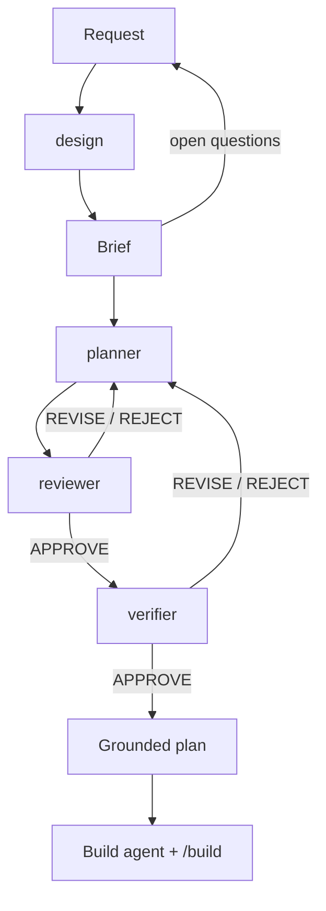

# agentic

A **starting point** for an AI-driven development environment on OpenCode v2 — not a set-in-stone guide. It points at the core skills, agents and MCP servers worth having, so a new machine reaches the intended outcomes quickly. Every part of it is meant to be edited, extended, or deleted.

Public domain — use it, copy it, alter it, steal it. See `LICENSE`.

## What this is

A blueprint in four parts, each installed to its own destination:

| Part | What it is | Expect to change it |
|---|---|---|
| `skills/` | Core skills, plus pointers to skills that live elsewhere | Grows and shrinks as better skills appear |
| `agents/` | A `design → planner → reviewer → verifier` pipeline | A default shape, not a requirement |
| `commands/` | `/build` and `/reviewer` | A convenience, not a mandate |
| `config/agentic.opencode.json` | The MCP servers, skill sources and plugins worth having | One person's shortlist |

`INSTALL.md` maps each part to its destination, and is written for an agent to execute. There is no deployment script.

**Take what fits and delete the rest.** This is a starting point, not an authority: the agents are one opinion about how to plan, the MCP list is what one person found useful, and most of the skills are pointers to work that lives elsewhere. `INSTALL.md` §7 covers removing what you drop.

### The pipeline

| # | Stage | Agent | Question it answers |
|---|---|---|---|
| 1 | Interrogate → brief → orchestrate | `design` (primary) | What is worth building, and why? |
| 2 | Plan | `planner` (subagent) | What is the decision-complete plan? |
| 3 | Review | `reviewer` (subagent) | Is the plan **sound**? |
| 4 | Verify | `verifier` (subagent) | Is the plan **true**? |

`design` is the only interactive stage and the only one permitted to launch subagents. It hands a grounded plan to the built-in `build` agent, which the `/build` command drives. See [Agent Orchestration](#agent-orchestration) for the loop and its limits.

Four things worth knowing before you edit anything here:

- `agents/plan.md` is a 13-line override that hides OpenCode's built-in `plan` agent. It contains no planning instructions.
- `commands/` holds only commands that have no agent of their own. A command that merely *invokes* an agent delegates with `agent:` instead of copying its prompt, so there is no second copy to drift.
- `design` and `verifier` exist only as agents; nothing invokes them as a command.
- `design` is deliberately **not** hidden. The other four are.

## Skills

### Hindsight

A session-end self-improvement skill that reviews everything accomplished in a session, distills genuine process lessons, and saves the durable ones as persistent memory. Trigger on:
- "get some hindsight"
- "run a hindsight pass"
- "what should we improve"
- "review today and notate lessons"
- "what did you learn today"
- "save what's worth remembering from this session"

Memory is stored globally at `~/.opencode/memory/`.

The skill is located at `skills/hindsight/SKILL.md`. Installing it copies the whole directory to `~/.config/opencode/skills/hindsight/`.

### Karpathy Guidelines

Behavioral guidelines to reduce common LLM coding mistakes, derived from [Andrej Karpathy's observations](https://x.com/karpathy/status/2015883857489522876). Loaded automatically by all four pipeline agents (`design`, `planner`, `reviewer`, `verifier`) at session start. Four principles in priority order:

1. **Goal-Driven Execution** (highest priority) — Transform tasks into verifiable goals with success criteria; loop until verified.
2. **Think Before Coding** — State assumptions explicitly; surface tradeoffs; push back when warranted.
3. **Simplicity First** — Minimum code that solves the problem; nothing speculative.
4. **Surgical Changes** — Touch only what you must; clean up only your own mess.

The skill is located at `skills/karpathy-guidelines/SKILL.md`. Installing it copies the whole directory to `~/.config/opencode/skills/karpathy-guidelines/`.

### Caveman

Ultra-compressed communication mode that cuts output tokens while keeping technical accuracy. Loaded by default by all four pipeline agents. It can also be activated manually via `/caveman`, "caveman mode", "talk like caveman", "be brief", or "less tokens". Four intensity levels: lite, full (default), ultra, and wenyan variants (classical Chinese). Derived from [JuliusBrussee/caveman](https://github.com/JuliusBrussee/caveman).

The skill is located at `skills/caveman/SKILL.md`. Installing it copies the whole directory to `~/.config/opencode/skills/caveman/`.

### Grill Me

A relentless interview that sharpens a plan, decision, or idea. Start it with `@grill-me` in a prompt. It is `disable-model-invocation: true`, so the model will not reach for it on its own — you invoke it deliberately.

**It is a pair, and vendoring only half of it is why this skill used to be broken.** `skills/grill-me/SKILL.md` is seven lines whose entire body is `Call the Skill tool with "grilling".` The interview itself lives in `skills/grilling/SKILL.md`. With `grilling` absent, `grill-me` was a pointer to nothing — which is exactly the state it was removed from this repo in. Both halves are required.

Both are vendored **verbatim** from [mattpocock/skills](https://github.com/mattpocock/skills), `skills/productivity/`. Two neighbouring skills are deliberately not included: `grill-with-docs` (the same interview but stateful — it reads the codebase and records `GLOSSARY.md` and ADRs) and `wayfinder` (grilling inside a larger effort map).

The skills are located at `skills/grill-me/SKILL.md` and `skills/grilling/SKILL.md`. Installing copies both directories to `~/.config/opencode/skills/`.

### Ponytail

The lazy-senior-dev ruleset: the smallest change that fully solves the task, and a reply a busy human understands in one read. Five companion skills ship with it (`ponytail-audit`, `ponytail-debt`, `ponytail-gain`, `ponytail-help`, `ponytail-review`), plus `/ponytail` commands and the `lite` / `full` / `ultra` / `off` levels.

It is installed as a **plugin**, not vendored, and that is deliberate: it injects its ruleset on every turn and owns the active level, neither of which a copied `SKILL.md` could do. Source: [DietrichGebert/ponytail](https://github.com/DietrichGebert/ponytail) (MIT). It is listed under the `plugins` key in `config/agentic.opencode.json`; see `INSTALL.md` §4.

## Persistent Memory

The project maintains global lessons learned from past sessions in `~/.opencode/memory/`. These lessons are automatically loaded at the start of each session through `AGENTS.md`, which all agents are required to read.

**Memory location:** `~/.opencode/memory/`

**How it works:**
- `AGENTS.md` instructs all agents to read `MEMORY.md` at session start
- `MEMORY.md` is the index listing all lessons
- Individual lesson files (e.g., `001-install-infrastructure.md`) contain the full lesson content
- The hindsight skill writes new lessons to this directory

### Proactive Hindsight Suggestions

After an implementation that required iteration or course correction, agents should suggest a hindsight pass. They should not run it automatically and should not suggest it after straightforward tasks or ordinary planning conversations.

### Cross-platform paths

`~/.opencode/memory/` is a home-relative logical path. On Unix-like systems it resolves under `/home/<user>/` or `/Users/<user>/`; on Windows it resolves under `C:\Users\<user>\`. Agents must resolve the user's home directory instead of hardcoding a platform-specific path.

### Permission configuration

To avoid repeated approval prompts when agents read or update global memory, add these rules to the global OpenCode config at `~/.config/opencode/opencode.jsonc` (on Windows, use the equivalent OpenCode configuration directory):

```jsonc
{
  "$schema": "https://opencode.ai/config.json",
  "permissions": [
    { "action": "external_directory", "resource": "~/.opencode/memory/*", "effect": "allow" },
    { "action": "read", "resource": "~/.opencode/memory/*", "effect": "allow" },
    { "action": "edit", "resource": "~/.opencode/memory/*", "effect": "allow" }
  ]
}
```

OpenCode expands the `~` prefix using the current user's home directory. Preserve the home-relative form on Windows; do not copy the Unix `/home/<user>/` example into Windows configuration.

**Current lessons:**
1. Install Infrastructure — Skills, agents and prompts install by file placement; `INSTALL.md` is the mechanism, and it needs no edit when the count changes
2. Avoid Hardcoding — Don't hardcode provider-specific values in portable agents
3. Clarify Requirements — Ask clarifying questions before implementing complex features
4. Test Integration — Test agent orchestration integration points early and iterate
5. Document Memory — Document memory system conventions for skills clearly

See `AGENTS.md` for the complete memory loading mechanism.

## Agent Orchestration

The `design` pipeline turns a request into a grounded plan. `design` is the only interactive stage, and the only stage permitted to launch subagents — every later stage runs unattended in a fresh context.

| # | Stage | Agent | Question it answers |
|---|---|---|---|
| 1 | Interrogate → brief → orchestrate | `design` (primary) | What is actually worth building, and why? |
| 2 | Plan | `planner` (subagent) | What is the decision-complete plan? |
| 3 | Review | `reviewer` (subagent) | Is the plan **sound**? |
| 4 | Verify | `verifier` (subagent) | Is the plan **true**? |

`design` dispatches the stages itself, in sequence, because a subagent cannot launch another subagent. `reviewer` must return APPROVE before `verifier` runs. The Reviewer → Verifier pair runs at most 3 times; unresolved concerns are then presented rather than looped on.



`agents/plan.md` is a 13-line override that hides OpenCode's built-in `plan` agent, so `design` is the only planning entry point. Delete it to restore the built-in.

`/build` and `/reviewer` are the two commands. `/build` is how a grounded plan reaches implementation; `/reviewer` is a manual entry point to the reviewer.

## Layout

```
agentic/
├── commands/
│   ├── build.md              # /build — execute a validated plan
│   └── reviewer.md           # /reviewer — delegates to the reviewer agent
├── agents/
│   ├── design.md             # Primary: interrogate, brief, orchestrate the pipeline
│   ├── planner.md            # Subagent: produce the plan
│   ├── reviewer.md           # Subagent: is the plan sound?
│   ├── verifier.md           # Subagent: is the plan true?
│   └── plan.md               # Override hiding the built-in `plan` agent
├── skills/
│   ├── hindsight/
│   │   └── SKILL.md          # Hindsight skill
│   ├── karpathy-guidelines/
│   │   └── SKILL.md          # Karpathy guidelines skill
│   ├── caveman/
│   │   └── SKILL.md          # Caveman skill
│   ├── grill-me/             # @grill-me — entry point; its body loads `grilling`
│   ├── grilling/             # the relentless interview itself
│   ├── llm-council/
│   │   └── SKILL.md          # LLM Council skill
│   └── stop-slop/            # Git submodule: hardikpandya/stop-slop
├── docs/
│   └── AGENTS-PLAN.md        # Pre-task checklist (P1-P8) referenced by AGENTS.md
├── config/
│   └── agentic.opencode.json # Config snippet to MERGE, not copy
├── INSTALL.md                # The installer — there is no deploy script
├── MCP.md                    # MCP server recommendations and install notes
├── AGENTS.md                # Project instructions (memory loading, conventions)
└── README.md
```

| Path | Purpose |
|---|---|
| `LICENSE` | The Unlicense — public domain. This repo is meant to be copied and altered. |
| `INSTALL.md` | **The installer.** Maps every object to its OpenCode v2 destination, and specifies the config merge. |
| `commands/build.md` | `/build` — executes a validated plan, runs its `## Verification`. |
| `commands/reviewer.md` | `/reviewer` — delegates to the `reviewer` agent with `agent:`. Holds no review logic of its own. |
| `agents/design.md` | Pipeline entry point. Primary, read-only. Interrogates, emits a brief, then dispatches planner → reviewer → verifier. |
| `agents/planner.md` | Subagent. Produces the plan. Cannot dispatch other agents. |
| `agents/reviewer.md` | Subagent. Judges the plan's soundness. Must APPROVE before the verifier runs. |
| `agents/verifier.md` | Subagent. Grounds the plan against the real repository — do the named paths and symbols exist? |
| `agents/plan.md` | Override that hides OpenCode's built-in `plan` agent, so `design` is the only planning entry point. Delete to restore the built-in. |
| `docs/AGENTS-PLAN.md` | The P1-P8 pre-task checklist that `AGENTS.md` tells agents to read before non-trivial work. |
| `skills/hindsight/SKILL.md` | Hindsight skill for session-end self-improvement. |
| `skills/karpathy-guidelines/SKILL.md` | Karpathy guidelines skill for planning, writing, and reviewing code. |
| `skills/caveman/SKILL.md` | Caveman skill for compressed communication style. |
| `skills/grill-me/SKILL.md` | `@grill-me` — user-invoked entry point; its entire body loads the `grilling` skill. |
| `skills/grilling/SKILL.md` | The relentless interview. Vendored verbatim from `mattpocock/skills`. |
| `skills/llm-council/SKILL.md` | LLM Council skill. The CLI itself lives in the `homelab` repo, `ai/council/`. |
| `skills/stop-slop` | Git submodule for `hardikpandya/stop-slop`. |
| `config/agentic.opencode.json` | Managed config merged into the target Opencode config. |
| `AGENTS.md` | Project instructions. Instructs agents to load persistent memory at session start. |

### Skills from other repositories

Three well-known skills were originally committed here as bare symlinks (`skills/obra-superpowers`, `skills/stop-slop`, `skills/understand-anything`). That could never work: the repo had no `.gitmodules`, so a clone produced empty directories, and two of the three are multi-skill **plugin** repositories with no root `SKILL.md` at all. They are now integrated the way each one actually expects:

| Skill | Source | Mechanism |
|---|---|---|
| `stop-slop` | [hardikpandya/stop-slop](https://github.com/hardikpandya/stop-slop) | Git submodule. The repo root is a single skill (`SKILL.md` + `references/`), so it drops straight into `skills/`. |
| Superpowers (15 skills) | [obra/superpowers](https://github.com/obra/superpowers) | Opencode **plugin**, via the `plugins` config key. Ships its own OpenCode support in `.opencode/INSTALL.md`. |
| Understand Anything (9 skills) | [Egonex-AI/Understand-Anything](https://github.com/Egonex-AI/Understand-Anything) | External checkout plus a `skills` config entry pointing at its `understand-anything-plugin/skills` directory. |
| `grill-me` + `grilling` | [mattpocock/skills](https://github.com/mattpocock/skills) | Two skill directories **vendored verbatim** under `skills/`, copied byte-for-byte from `skills/productivity/`. MIT. |
| Ponytail (6 skills, `/ponytail`) | [DietrichGebert/ponytail](https://github.com/DietrichGebert/ponytail) | Opencode **plugin**, via the `plugins` config key. Ships first-class OpenCode support in `.opencode/plugins/` and `.opencode/command/`, so it is installed as a plugin rather than vendored — a copy would lose the per-turn ruleset injection and the level state. MIT. |

`mattpocock/skills` is a 38-skill collection, so the repository itself must not go under `skills/` — OpenCode would register every nested skill and collide with the ones already installed. Only the two directories needed are vendored, each with a root `SKILL.md`, which is the same shape as `caveman`, `hindsight`, `karpathy-guidelines` and `llm-council`. The cost of vendoring is that upstream fixes do not arrive on their own: re-copy from `skills/productivity/grill-me/` and `.../grilling/` when you want to move.

Init the submodule after cloning:

```sh
git submodule update --init --recursive
```

Superpowers and Understand Anything are **not** submodules: both are large multi-harness plugin repositories whose skills live in nested directories, and Superpowers needs its bootstrap injection to work. Vendoring them would pin them to a commit and skip upstream's cross-harness tooling.

`Egonex-AI/Understand-Anything` was formerly `Lum1104/Understand-Anything`; GitHub redirects the old name, so either URL resolves.

### Plugin config key

The managed config uses **`plugins`**, the V2 field. V2's schema marks `plugin` (singular, the V1-line spelling) as deprecated and ignores it, so a target config that still carries the old key needs it renamed by hand — plugins listed under `plugin` will not load.

If a plugin silently fails to load, check which spelling your build wants:

```sh
grep -i 'normalization diagnostic' ~/.local/share/opencode/log/opencode.log
```

A rejected key is reported as `path=$.plugin kind=invalid action="skipped"`.


## Installing

There is no deployment script. `INSTALL.md` is the installer: it maps every object in this repo to its OpenCode v2 destination, and it is written so an AI agent can execute it end to end. Point your agent at it:

> Read `INSTALL.md` and install this.

The mapping in short — `INSTALL.md` §1 has the per-project column:

| Object | Global destination |
|---|---|
| `agents/<name>.md` | `~/.config/opencode/agents/` |
| `commands/<name>.md` | `~/.config/opencode/commands/`, invoked as `/<name>` |
| `skills/<id>/` | `~/.config/opencode/skills/<id>/` |
| `AGENTS.md` | `~/.config/opencode/AGENTS.md`, inside a marker pair |
| `config/agentic.opencode.json` | merged into `~/.config/opencode/opencode.jsonc` |

Prefer the global install: the pipeline agents are useful in every project.

### Why the config is merged rather than copied

OpenCode loads exactly one extra config file, selected by `OPENCODE_CONFIG`. Dropping a second `*.opencode.json` into the config directory does nothing — it is silently ignored. Everything the snippet declares must be merged into the target's own `opencode.json(c)`.

That is the one step a plain file copy cannot do, so `INSTALL.md` §4 spells out the merge rules. Back the target up first — rewriting it as JSON drops `//` comments. Secrets are never written into config: the GitHub server reads its token from `{env:GITHUB_PERSONAL_ACCESS_TOKEN}`.

### Idempotency

Re-installing produces the same result. This matters because the global config directory is shared state that other tools also write to.

- **AGENTS.md** is wrapped in a marker pair. A repeat install replaces that block in place and leaves every other byte of the file alone.
- **MCP servers** are merged by name. Only the keys defined in `config/agentic.opencode.json` are written; every other setting in the target config is preserved, including legacy servers declared directly under `mcp`.
- **`skills` and `plugins`** are merged as ordered unions: your existing entries keep their precedence and new ones are appended. Order matters for both, so never sort them.

### External checkouts

The `skills` entry in `config/agentic.opencode.json` points into an Understand Anything checkout, so that checkout has to exist before those nine skills resolve. `INSTALL.md` §2 clones it; skip that and drop the entry instead. **Never update an existing checkout as part of an install** — an install must not silently move your dependency versions. Update it yourself when you want to move:

```sh
git -C ~/.understand-anything/repo pull --ff-only
```

### Servers registered disabled

`config/agentic.opencode.json` ships two entries with `"disabled": true`:

| Server | Why |
|---|---|
| `graphify` | Serves a prebuilt `graphify-out/graph.json` from the working directory, so it only connects in a project where `graphify .` has been run. |
| `claude_context` | Needs a Zilliz Cloud account for the embedding backend. |

Flip `"disabled"` to `false` (or use `/mcps` in the TUI) once the prerequisite exists. See `MCP.md` for prerequisites and corrected install commands.

### Troubleshooting

**A skill directory is skipped as "empty" or "SKILL.md not found".** Either the submodule is unpopulated (`git submodule update --init --recursive`) or it is a multi-skill plugin repository, which belongs in the config's `skills` array rather than in `skills/`.

**A plugin or skill silently fails to load.** Check the server log for rejected config keys:

```sh
grep -i 'normalization diagnostic' ~/.local/share/opencode/log/opencode.log
```

`action="skipped"` with `kind=invalid` names the offending path. Note that `opencode mcp list` does **not** fully validate the config; start the server (`opencode serve`) to surface every diagnostic.

**A git-backed plugin spec fails on Windows.** Upstream documents that some Windows builds mishandle `git+https` specs. Fall back to a local install and point the config at the absolute path (Opencode does not expand `~`):

```powershell
npm install superpowers@git+https://github.com/obra/superpowers.git --prefix "$HOME\.config\opencode"
```

then use `C:\Users\<you>\.config\opencode\node_modules\superpowers` as the `plugins` entry.

### AGENTS.md placement

The global `AGENTS.md` is shared state: other tools and other machines write to it, so the block this repo owns is wrapped in a marker pair and **replaced in place** on a re-install, never appended a second time.

For a per-project install the file goes at `<project>/AGENTS.md`. OpenCode discovers instruction files from the workspace up toward your home directory, stopping at the project root, so `<project>/.opencode/AGENTS.md` would only load if an agent happened to read inside `.opencode/` — not what you want for repository-wide guidance.

`INSTALL.md` §5 has the exact procedure, including the legacy `<!-- Appended from agentic project -->` block that older installs left behind.

### Verify

See `INSTALL.md` §6. In short:

```sh
opencode debug config    # the merged config, as OpenCode actually loaded it
opencode debug agents    # agent IDs, modes and hidden flags
```

`design` must appear as `primary` and **not** hidden; `planner`, `reviewer` and `verifier` are `subagent` and hidden. If `debug agents` shows `plan` as visible, the install predates the design pipeline.

## Usage

### Design pipeline

**TUI:** Switch to the `design` agent, describe what you want, and answer its questions. It emits a design brief, then runs `planner` → `reviewer` → `verifier` on your behalf. Once it presents the grounded plan, switch to the `build` agent and run `/build`.

**CLI:**

```sh
opencode run --agent design "<request>"
```

`design` is read-only — no file edits, no shell. That is deliberate: the plan is interrogated, reviewed and grounded before anything is implemented.

### /build

Executes the validated plan from the conversation. It refuses to run without one: with no plan in context it stops rather than inferring one from the surrounding conversation. It runs the plan's `## Verification` section and reports the real command and the real output, not a summary that it passed.

### Commands

`/reviewer` gives a one-off review without running the whole pipeline. It delegates to the `reviewer` agent rather than carrying a copy of its prompt. `/build` is described above.

### Hindsight Skill

**Trigger phrases:**
- "get some hindsight"
- "run a hindsight pass"
- "what should we improve"
- "review today and notate lessons"
- "what did you learn today"
- "save what's worth remembering from this session"

**Behavior:**
- Reviews the full session end-to-end
- Extracts durable process lessons (not one-off specifics)
- Saves lessons as persistent memory at `~/.opencode/memory/`
- Updates existing memory entries instead of creating duplicates
- If no memory system exists, produces a standalone document

## Permission model

Every agent starts from the same base policy (`*` allow, `.env` reads ask) and appends ordered rules; the last matching rule wins.

| Agent | Edit | Shell | Subagents | Notes |
|---|---|---|---|---|
| `design` | deny | deny | deny `*`, then allow `planner`, `reviewer`, `verifier` | Also allows `question` — it is the only interactive stage |
| `planner` | deny | deny | deny | Read-only; cannot run the review stages itself |
| `reviewer` | deny | deny | deny | Read-only; also denies `todowrite` |
| `verifier` | deny | deny | deny | Read-only; cannot repair what it finds missing |

`design` denies `subagent` broadly and then re-allows three specific IDs, so rule order matters: broad rule first, exceptions after it.

## Commands, and why they are not copies

`commands/` holds slash commands. Each is a separate file from any agent with a similar name, and editing one does not update the other.

Only two exist, and both earn their place:

- `commands/build.md` — no agent can replace it, because `/build` is how a grounded plan reaches implementation.
- `commands/reviewer.md` — a four-line wrapper with `agent: reviewer`. It holds **no** review logic; it invokes the agent. If it copied the agent's prompt instead, the two would drift — which is exactly what happened to this repo's old `prompts/plan-mode.md`, a 95-line copy of the planner prompt that kept describing a review loop the planner had since been forbidden to run.

`design` and `verifier` have no command; nothing invokes them that way.

## Behaviors & troubleshooting

- **Provider flake:** Some providers occasionally return empty completions or truncate at the output-token limit. Fix: rerun the request.
- **Don't trust the model's self-reported tool list** ("list every tool available to you"). Models omit tools from their enumeration. Trust `opencode debug agents` instead.
